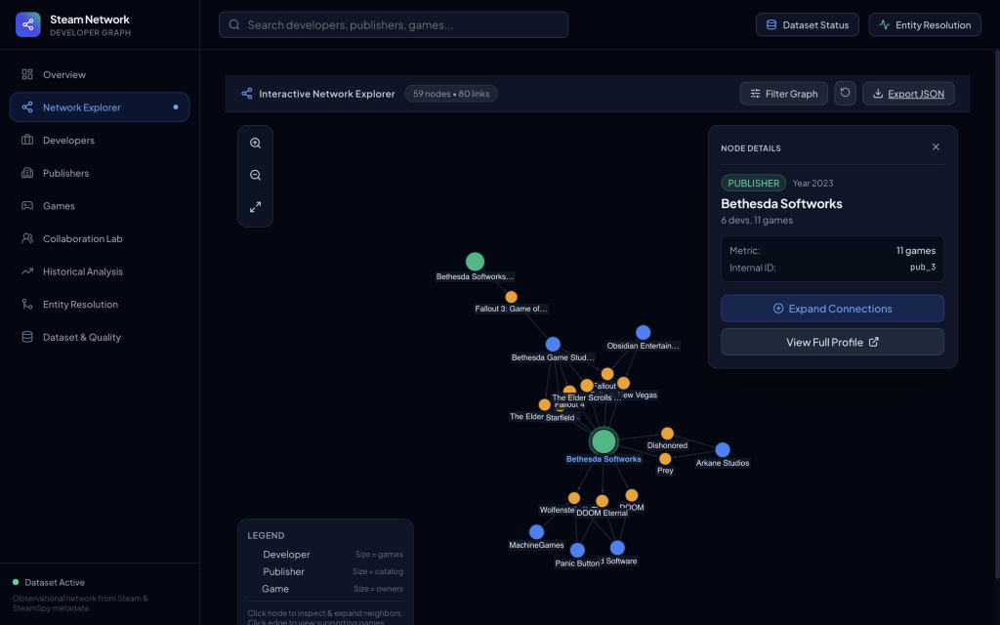
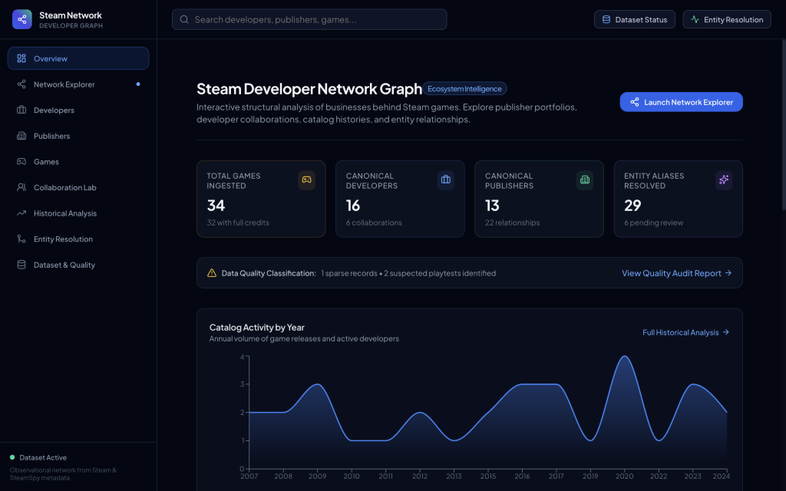
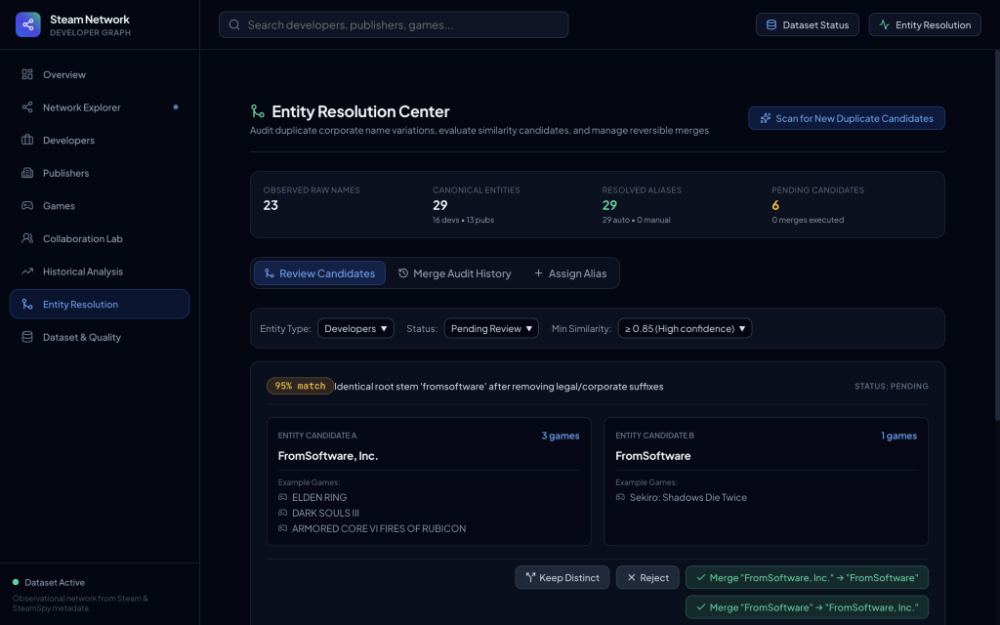
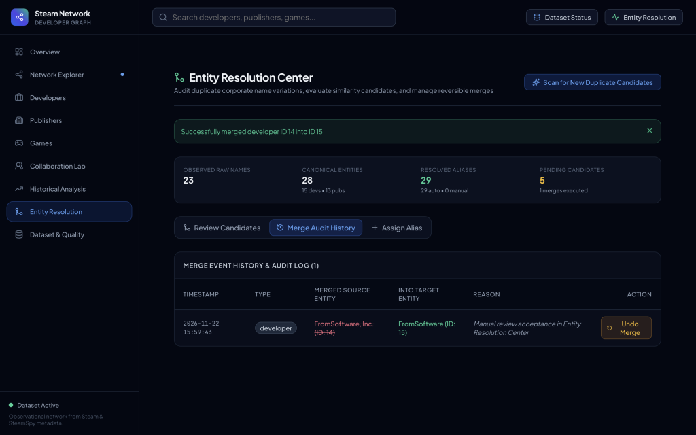
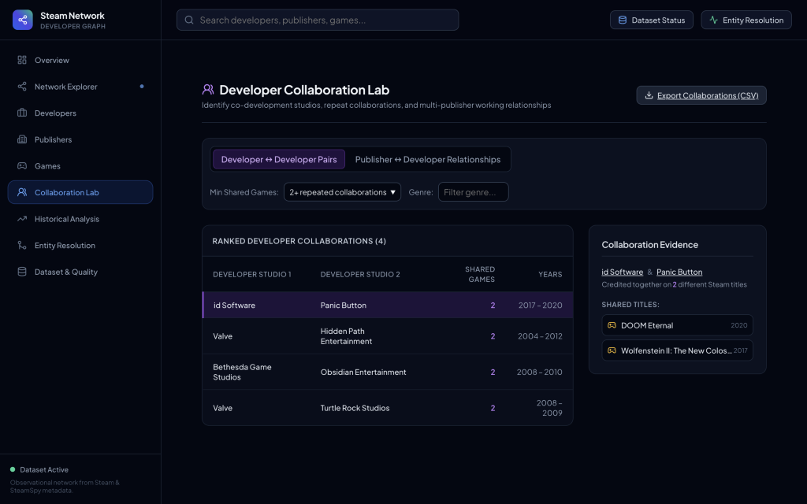
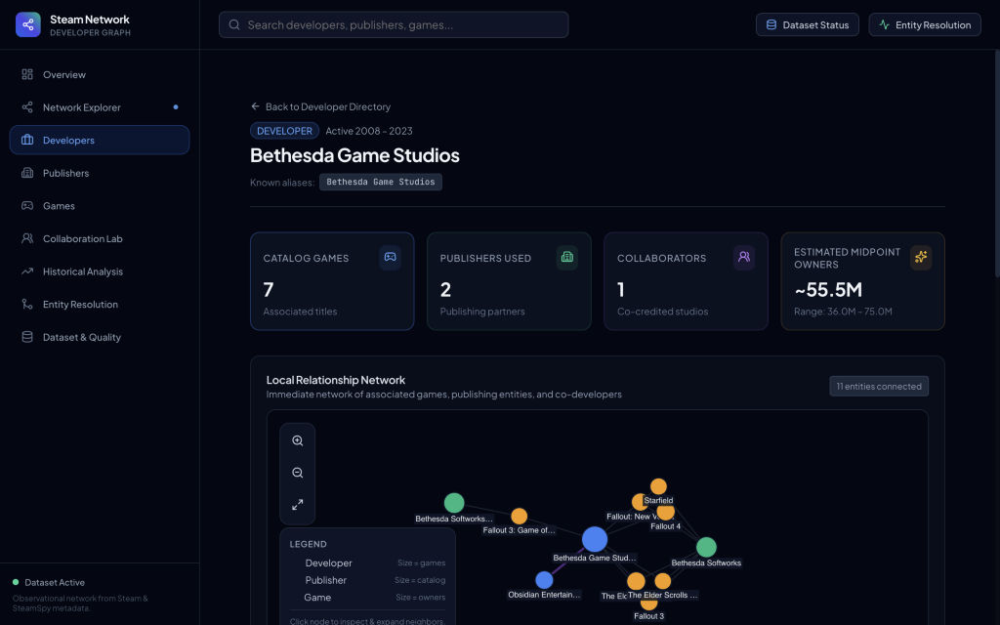
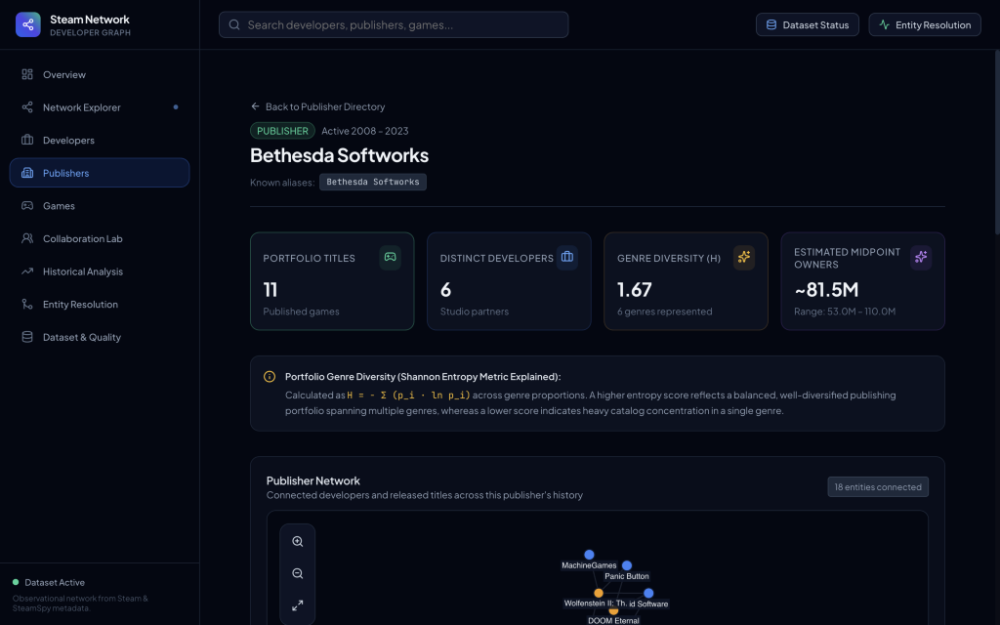
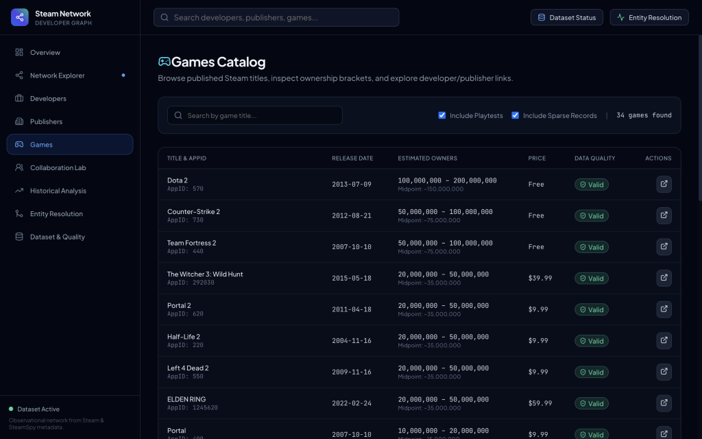
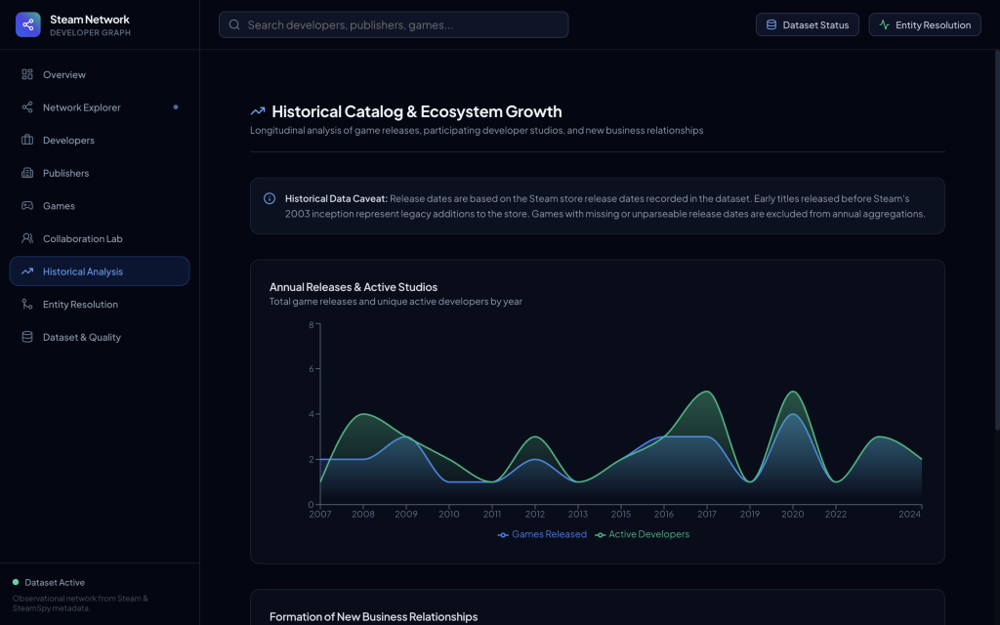
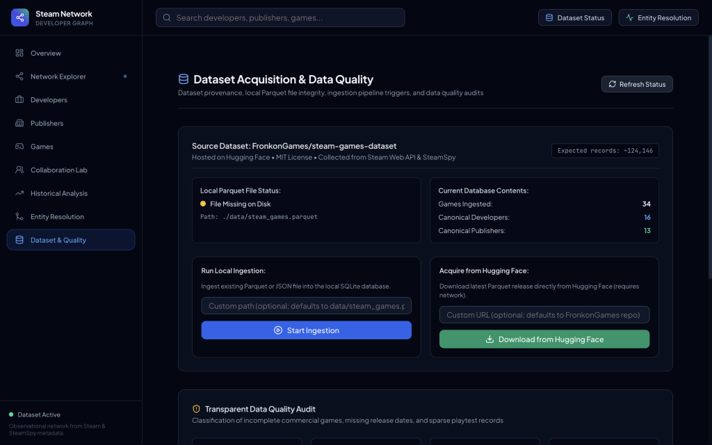

# Steam Developer Network Graph

**Steam Developer Network Graph** is a network analysis and business intelligence platform that models and explores the structural relationships connecting game developers, publishers, titles, genres, release eras, and ownership brackets across the Steam gaming ecosystem.


_Interactive 2D force-directed network explorer visualizing bipartite and multigraph connections across developers (blue), publishers (emerald), and games (amber), with live node inspection and neighborhood expansion._

---

## Overview & Problem Solved

Standard game industry directories present isolated leaderboards or static tables where raw metadata noise obscures real corporate structures. On Steam, a single studio or publisher frequently appears under multiple legal variations (`Valve` vs. `Valve Corporation`, `Bethesda Softworks` vs. `Bethesda Softworks LLC`, `FromSoftware, Inc.` vs. `FromSoftware`), while temporary playtest apps and incomplete store records skew catalog counts.

**Steam Developer Network Graph** solves this by combining:

1. **Observational Bipartite & Multigraph Modeling**: Derives evidence-backed edges between studios and publishing labels directly from shared game credits.
2. **Multi-Signal Entity Resolution**: Normalizes noisy corporate strings, scores duplicate candidates using Jaro-Winkler, Levenshtein, Sørensen-Dice, and legal-stem matching, and provides a human-in-the-loop review queue with completely reversible merges.
3. **Portfolio Diversity & Collaboration Analytics**: Quantifies publisher specialization vs. diversification via Shannon entropy ($H$) and uncovers repeat co-development partnerships.
4. **Transparent Data Quality Auditing**: Automatically flags sparse metadata and suspected playtest records (`is_sparse`, `is_likely_playtest`) so analysts can filter them dynamically without destructive data loss.

---

## Key Features

- **Interactive Network Explorer**: Canvas-based 2D force-directed graph (`react-force-graph-2d`) supporting bounded neighborhood traversal, dynamic node sizing by catalog volume or estimated ownership, release-year and genre filters, and one-click neighborhood expansion.
- **Entity Resolution Center**: Automated candidate discovery pairing conservative Unicode NFKC normalization with legal suffix reduction (`Ltd`, `LLC`, `Inc`, `GmbH`, `Corp`, `Studios`, `Games`, `Entertainment`). Review candidates side-by-side, execute audited merges, mark entities as distinct, or reverse prior merges with full relationship restoration.
- **Developer & Publisher Intelligence**: Dedicated directories and deep profile pages featuring local relationship subgraphs, annual release timelines, publishing partner breakdowns, Shannon entropy genre concentration charts, and ownership range estimates.
- **Developer Collaboration Lab**: Ranked co-development studio pairs and publisher-developer partnerships with supporting game credit evidence.
- **Data Quality & Ingestion Pipeline**: Streaming Apache Arrow / Parquet and JSON/JSONL ingestion engine with SHA-256 file verification, idempotent upserts, and granular quality issue tracking.
- **CLI & Data Exports**: Full command-line interface and REST endpoints for exporting filtered developer directories, publisher portfolios, collaboration pairs (CSV), and queried subgraphs (JSON).

---

## Visual Walkthrough & Screenshot Gallery

### 1. Ecosystem Intelligence Dashboard


_Global ecosystem summary displaying total ingested games, canonical developers, canonical publishers, resolved entity aliases, data quality classification banner, and longitudinal release activity._

### 2. Entity Resolution Center & Reversible Merge Audit


_Human-in-the-loop duplicate candidate review comparing `FromSoftware, Inc.` and `FromSoftware` (95% match on root stem) with example catalog titles and directional merge controls._


_Every canonical entity merge is recorded in an immutable audit log (`entity_merge_events`) with a snapshot of transferred game relationships, allowing one-click reversal (`Undo Merge`) that restores original catalog counts._

### 3. Developer Collaboration Lab


_Co-development analysis identifying studios credited together across multiple Steam titles (e.g., `id Software` & `Panic Button`, `Valve` & `Hidden Path Entertainment`, `Bethesda Game Studios` & `Obsidian Entertainment`) alongside supporting release evidence._

### 4. Developer & Publisher Profiles


_Developer Profile view (`Bethesda Game Studios`) showing catalog KPIs, estimated ownership range, and an interactive local relationship network connecting titles, co-developers, and publishing labels._


_Publisher Profile view (`Bethesda Softworks`) highlighting portfolio genre diversity via Shannon entropy ($H = 1.67$), partner studio count, and connected developer-game subgraphs._

### 5. Games Catalog, Historical Trends & Data Quality Audit


_Searchable games catalog with SteamSpy ownership brackets, midpoint approximations, store pricing, and real-time toggles for playtests and sparse records._


_Historical analysis tracking annual game release volume, active development studios, and first-time business relationship formation._


_Dataset provenance tracker and transparent data quality report classifying sparse metadata, suspected playtests, and missing credits._

---

## Architecture & Technology Stack

```text
steam-developer-graph/
├── backend/                  # Rust HTTP backend & analytical engine (Cargo edition 2024)
│   ├── src/
│   │   ├── api/              # Axum HTTP router, handlers & JSON response envelopes
│   │   ├── db/               # SQLite connection pool (r2d2), schema migrations & analytical queries
│   │   ├── entity_resolution/# String normalizer, multi-signal matcher & reversible merge manager
│   │   ├── export/           # CSV directory/collaboration & JSON subgraph serializers
│   │   ├── graph/            # Bipartite/multigraph models, neighborhood traversal & metrics
│   │   ├── ingestion/        # Parquet/JSON streaming loader, quality heuristics & HF downloader
│   │   ├── bin/
│   │   │   ├── server.rs     # Axum API server entrypoint (http://127.0.0.1:3001)
│   │   │   └── cli.rs        # CLI for dataset download, ingestion, status, resolution & exports
│   │   └── lib.rs            # Shared backend library crate (steam_developer_graph)
│   └── tests/                # Unit tests, API route tests & full-pipeline integration tests
│
├── frontend/                 # React 19 + TypeScript 5 + Vite 6 single-page application
│   ├── src/
│   │   ├── api/              # Typed REST API client
│   │   ├── components/       # Layout shell, global autocomplete search & 2D force graph canvas
│   │   ├── types/            # TypeScript interfaces aligned with Rust serde models
│   │   ├── utils/            # Formatters for ownership brackets, USD prices, playtime & entropy
│   │   └── views/            # Application views (Overview, Network, Directories, Profiles, ER, Dataset)
│   └── tests/                # Vitest + React Testing Library suites
│
├── docs/
│   └── screenshots/          # Verified application screenshots
└── data/                     # Local SQLite database & Parquet dataset storage (git-ignored)
```

- **Backend**: Rust, Axum 0.8, Tokio, SQLite (`rusqlite` bundled + `r2d2`), Apache Arrow & Parquet 60.1, Clap 4.6, Strsim, Reqwest, Serde.
- **Frontend**: React 19, TypeScript 5.7, Vite 6, `react-force-graph-2d`, Recharts, Lucide Icons.
- **Testing**: Cargo test (unit + integration), Vitest 5, `@testing-library/react`.

---

## Installation & Quick Start

### Prerequisites

- **Rust**: 1.85+ with Cargo (`rustup update`)
- **Node.js**: 22+ with `pnpm` or `npm`

### 1. Clone and Install Dependencies

```bash
git clone https://github.com/LaymanMax/steam-developer-graph.git
cd steam-developer-graph

# Install frontend dependencies
cd frontend && pnpm install && cd ..
```

### 2. Ingest Dataset Records

Ingest the included sample fixture to populate the local SQLite database (`./data/steam_games.db`) immediately:

```bash
cargo run --manifest-path backend/Cargo.toml --bin cli -- ingest --file backend/tests/fixtures/sample_games.json
```

Or download and ingest the full **FronkonGames Steam Games Dataset** (~124,000+ games) from Hugging Face:

```bash
# Download ./data/steam_games.parquet from Hugging Face
cargo run --manifest-path backend/Cargo.toml --bin cli -- download

# Stream-ingest the Parquet file into SQLite
cargo run --manifest-path backend/Cargo.toml --bin cli -- ingest
```

### 3. Start the Backend and Frontend Servers

Start the Rust API server (listens on `http://127.0.0.1:3001`):

```bash
npm run dev:backend
```

In a second terminal, start the Vite development server (listens on `http://localhost:5173`):

```bash
npm run dev:frontend
```

Open `http://localhost:5173` in your browser.

---

## Configuration

The application runs out of the box with sensible local defaults. You can customize settings via environment variables (see [`.env.example`](./.env.example)):

```ini
# Backend configuration
PORT=3001
HOST=127.0.0.1
DATABASE_PATH=./data/steam_games.db
DATASET_PATH=./data/steam_games.parquet
RUST_LOG=info

# Frontend configuration
VITE_API_URL=http://127.0.0.1:3001
```

---

## CLI Usage & Practical Examples

The backend includes a full-featured CLI binary (`backend/src/bin/cli.rs`) for data engineering, status auditing, entity resolution, and batch exports.

```bash
# View CLI help and subcommands
cargo run --manifest-path backend/Cargo.toml --bin cli -- --help
```

### Check Database & Data Quality Status

```bash
cargo run --manifest-path backend/Cargo.toml --bin cli -- status
```

Example output:

```text
Steam Developer Network Graph Status:
=====================================
Database:   "./data/steam_games.db"
Games:      34
Developers: 16
Publishers: 13
Genres:     11

Data Quality Summary:
Sparse records:           1
Likely playtests:         2
Complete credits games:   32
Missing release dates:    1
```

### Scan for Entity Resolution Candidates

```bash
# Discover duplicate candidate pairs for developers or publishers
cargo run --manifest-path backend/Cargo.toml --bin cli -- resolve --entity-type developer --limit 100
cargo run --manifest-path backend/Cargo.toml --bin cli -- resolve --entity-type publisher --limit 100
```

### Export Directories, Collaborations & Graph Subgraphs

```bash
# Export canonical developers directory to CSV
cargo run --manifest-path backend/Cargo.toml --bin cli -- export --target developers --output ./developers.csv

# Export canonical publishers directory (with Shannon entropy scores) to CSV
cargo run --manifest-path backend/Cargo.toml --bin cli -- export --target publishers --output ./publishers.csv

# Export co-development collaboration pairs to CSV
cargo run --manifest-path backend/Cargo.toml --bin cli -- export --target collaborations --output ./collaborations.csv

# Export the macro ecosystem network subgraph to JSON
cargo run --manifest-path backend/Cargo.toml --bin cli -- export --target graph --output ./subgraph.json
```

---

## REST API Reference

All API endpoints are served from `http://127.0.0.1:3001` and return a standardized JSON envelope (`{ "success": true, "data": ... }`), except file export routes which return `text/csv` or `application/json` attachments.

| Method | Endpoint                                  | Description                                                               |
| ------ | ----------------------------------------- | ------------------------------------------------------------------------- |
| `GET`  | `/api/overview/summary`                   | Global network summary, top rankings, and data quality counts             |
| `GET`  | `/api/search?q={term}`                    | Multi-entity autocomplete search across developers, publishers, and games |
| `GET`  | `/api/graph/overview`                     | Macro-level bipartite subgraph of leading developers, publishers, & games |
| `GET`  | `/api/graph/neighborhood`                 | Subgraph neighborhood centered on a node (`node_type`, `id`, `depth`)     |
| `GET`  | `/api/developers`                         | Paginated directory of canonical developers with filtering and sorting    |
| `GET`  | `/api/developers/{id}`                    | Complete developer profile, aliases, catalog, collaborators, and timeline |
| `GET`  | `/api/developers/{id}/network`            | Local network subgraph centered on a developer                            |
| `GET`  | `/api/publishers`                         | Paginated directory of canonical publishers with Shannon entropy metrics  |
| `GET`  | `/api/publishers/{id}`                    | Complete publisher profile, studio partners, and genre distribution       |
| `GET`  | `/api/publishers/{id}/network`            | Local network subgraph centered on a publisher                            |
| `GET`  | `/api/games`                              | Paginated games catalog with playtest, sparse, year, and owner filters    |
| `GET`  | `/api/games/{id}`                         | Detailed game metadata, credits, reviews, playtime, and related titles    |
| `GET`  | `/api/games/{id}/network`                 | Local connection hub subgraph centered on a game                          |
| `GET`  | `/api/collaborations`                     | Ranked co-development studio pairs sharing game credits                   |
| `GET`  | `/api/collaborations/{dev1_id}/{dev2_id}` | Shared game credits connecting two specific developers                    |
| `GET`  | `/api/relationships/publisher-developer`  | Ranked publisher-developer working relationships                          |
| `GET`  | `/api/historical/timeline`                | Annual game release volume, active studios, and new relationship counts   |
| `GET`  | `/api/historical/genres`                  | Longitudinal genre distribution trends                                    |
| `GET`  | `/api/entity-resolution/candidates`       | Paginated duplicate candidate pairs for review                            |
| `GET`  | `/api/entity-resolution/report`           | Entity resolution coverage metrics and alias counts                       |
| `GET`  | `/api/entity-resolution/history`          | Audit trail of executed and undone merge events                           |
| `POST` | `/api/entity-resolution/merge`            | Execute an audited canonical entity merge                                 |
| `POST` | `/api/entity-resolution/reject`           | Reject a suggested candidate pair                                         |
| `POST` | `/api/entity-resolution/mark-distinct`    | Permanently mark two entities as distinct                                 |
| `POST` | `/api/entity-resolution/assign-alias`     | Manually map a raw name string to a canonical entity ID                   |
| `POST` | `/api/entity-resolution/undo`             | Reverse a previous merge event and restore original relationships         |
| `POST` | `/api/entity-resolution/generate`         | Trigger candidate generation across active developers and publishers      |
| `GET`  | `/api/dataset/status`                     | Ingestion status, local Parquet checksum/size, and database entity counts |
| `GET`  | `/api/dataset/quality`                    | Data quality audit report and issue breakdown                             |
| `POST` | `/api/dataset/import`                     | Trigger local Parquet or JSON file ingestion                              |
| `POST` | `/api/dataset/download`                   | Trigger background dataset download from Hugging Face                     |
| `GET`  | `/api/export/developers`                  | CSV export of filtered developers directory                               |
| `GET`  | `/api/export/publishers`                  | CSV export of filtered publishers directory                               |
| `GET`  | `/api/export/collaborations`              | CSV export of developer collaboration pairs                               |
| `GET`  | `/api/export/graph`                       | JSON export of queried network subgraph                                   |

---

## Analytical Methodology & Data Caveats

### Shannon Entropy Portfolio Diversity

To evaluate whether a publisher specializes in a single genre niche or maintains a diversified catalog across multiple genres, the engine computes the Shannon entropy ($H$) of each publisher's genre distribution:

$$H = -\sum_{i=1}^{k} p_i \ln(p_i)$$

Where $p_i$ is the proportion of genre assignments in the publisher's catalog belonging to genre $i$.

- **Low entropy ($H \approx 0.00$)**: Highly specialized in a single genre.
- **High entropy ($H > 1.50$)**: Broadly diversified across Action, RPG, Adventure, Strategy, Simulation, and Indie titles.

### Observational Relationship Edges

Steam store metadata does not expose private corporate ownership contracts. All network relationships in this platform are strictly observational and backed by explicit game credits:

- **Developer–Publisher Edge**: Exists between Developer $A$ and Publisher $B$ if and only if there is at least one Game $G$ where $A \in \text{Developers}(G)$ and $B \in \text{Publishers}(G)$.
- **Co-Development Edge**: Exists between Developer $A$ and Developer $B$ ($A \neq B$) if and only if there is at least one Game $G$ where $\{A, B\} \subseteq \text{Developers}(G)$.

### Dataset Attribution & Caveats

- **Dataset Source**: [Hugging Face: FronkonGames/steam-games-dataset](https://huggingface.co/datasets/FronkonGames/steam-games-dataset) (MIT License), compiled from the Steam Web API and SteamSpy.
- **Estimated Ownership Brackets**: Ownership figures reflect SteamSpy sampling brackets (e.g., `10,000,000 - 20,000,000`). Both lower and upper bounds are preserved alongside a midpoint approximation (`~15,000,000`) for ranking and visual scaling; these are observational estimates rather than audited unit sales.
- **Sparse & Playtest Records**: Store entries lacking credits/dates or matching playtest heuristics (e.g., `AppID: 2539430 - Black Dragon Mage Playtest`) are automatically flagged during ingestion and can be toggled in or out of queries.

---

## Testing & Verification

Run the complete automated test suite across both the Rust backend and React frontend:

```bash
npm test
```

Or run individual test and build suites:

```bash
# Run Rust unit tests, API route tests, and full-pipeline integration tests
npm run test:backend

# Run Frontend Vitest unit and component tests
npm run test:frontend

# Type-check and build the production frontend bundle
npm run build:frontend
```

---

## Contributing

Contributions are welcome! Please read [CONTRIBUTING.md](./CONTRIBUTING.md) and our [Code of Conduct](./CODE_OF_CONDUCT.md) before submitting a pull request.


## License & Custom Work

[](mailto:work@withrana.com) [](https://www.linkedin.com/in/workwithrana)
[](https://www.upwork.com/freelancers/~01bbcf6edb91a8df5f)
[](https://contra.com/ranajahanzaib/)

**License:** MIT, see [LICENSE](LICENSE). Free for personal and commercial use.

**Author:** Rana Jahanzaib (aka LaymanMax)

**Need this built for your stack?** Email me what you're working on: work@withrana.com

